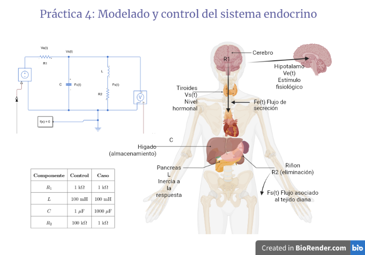

# Práctica 4 — Modelado y control del sistema endócrino

Repositorio académico de la asignatura **Modelado de Sistemas Fisiológicos**, correspondiente al programa de **Ingeniería Biomédica** del Tecnológico Nacional de México / Instituto Tecnológico de Tijuana. Esta práctica integra la interpretación fisiológica, la construcción de circuitos eléctricos equivalentes, el modelado matemático, el análisis temporal y de estabilidad, el diseño de controladores PID, la simulación computacional y la verificación experimental en el Laboratorio de Electrónica.

El caso de estudio representa el **sistema endócrino** mediante un modelo fenomenológico simplificado de segundo orden, compuesto por dos resistencias, una capacitancia y una inductancia. Se busca reproducir y comparar la respuesta de una condición de referencia (**control**) con una condición alterada (**caso**), tanto en lazo abierto como en lazo cerrado, mediante una estrategia de control orientada a reducir las diferencias entre ambas respuestas.

**Docente:** Dr. Paul Antonio Valle Trujillo  
**Correo:** paul.valle@tectijuana.edu.mx  
**Departamento:** Ingeniería Eléctrica y Electrónica  
**Institución:** Tecnológico Nacional de México / Instituto Tecnológico de Tijuana  
**Asignatura:** Modelado de Sistemas Fisiológicos  
**Programa:** Ingeniería Biomédica  
**Estudiante:** Carolina Gamez Flores · 23212193 · l23212193@tectijuana.edu.mx

**Repositorio de la asignatura:** https://github.com/DrPaulValle/MSF-IBF1020  
**Sede:** Blvd. Alberto Limón Padilla s/n, Tijuana, C. P. 22454, B. C., México.

---

## Contenido

1. [Resumen](#resumen)
2. [Competencia y objetivos](#objetivos)
3. [Relación con el temario](#temario)
4. [Modelo físico y analogía eléctrica](#analogia)
5. [Formulación matemática](#modelo)
6. [Análisis temporal y de estabilidad](#analisis)
7. [Señales de entrada y condiciones de simulación](#senales)
8. [Implementación en MATLAB, Simulink y Simscape](#matlab)
9. [Control en lazo cerrado y sintonización PID](#pid)
10. [Reproducción en Python](#python)
11. [Controlador analógico y laboratorio](#laboratorio)
12. [Resultados y verificación cruzada](#resultados)
13. [Flujo de trabajo](#flujo)
14. [Actividades del estudiante](#actividades)
15. [Estructura del repositorio](#estructura)
16. [Requisitos](#requisitos)
17. [Reproducibilidad y entregables](#reproducibilidad)
18. [Referencias](#referencias)

---

## Resumen

La práctica tiene como propósito **desarrollar un procedimiento de modelado, análisis, simulación y control** del sistema endócrino mediante una analogía eléctrica de segundo orden. El modelo representa de manera simplificada los procesos de secreción, transporte, almacenamiento y respuesta hormonal utilizando dos resistencias $R_1$ y $R_2$, una capacitancia $C$ y una inductancia $L$. A partir de las leyes de Kirchhoff se formulan las ecuaciones integro-diferenciales del circuito, se obtiene su función de transferencia mediante la transformada de Laplace y se analizan los polos, la estabilidad y el error en estado estacionario.

Se comparan dos condiciones: un **individuo de referencia (control)** y un **caso simulado de respuesta hormonal alterada**, representado mediante la modificación simultánea de la capacitancia $C$ y la resistencia $R_2$. Se aplica una entrada escalón unitario para evaluar las respuestas en lazo abierto y posteriormente se incorpora un **controlador PID con retroalimentación negativa**, sintonizado mediante la herramienta Tune de Simulink, con la finalidad de aproximar la respuesta del caso a la del control. Los modelos se implementan en MATLAB/Simulink y Simscape Electrical, mientras que sus resultados se reproducen mediante Python para realizar una verificación computacional cruzada.

La práctica integra la **implementación experimental en el Laboratorio de Electrónica**, mediante la construcción de los circuitos eléctricos equivalentes correspondientes al control y al caso, así como del controlador analógico. Las respuestas en lazo abierto y en lazo cerrado se registran mediante osciloscopio y se contrastan con las simulaciones desarrolladas en MATLAB/Simulink, Simscape Electrical y Python, considerando las características dinámicas de los componentes y las diferencias entre los resultados computacionales y experimentales.

Esta práctica corresponde a un ejercicio de **modelado y verificación computacional y experimental**. Su finalidad es interpretar la relación entre los elementos eléctricos y los procesos fisiológicos que representan, comparar el comportamiento dinámico de dos condiciones del sistema endócrino y evaluar una estrategia de control clásico. La analogía es de carácter fenomenológico y académico; los valores de sus componentes no representan directamente magnitudes fisiológicas medidas experimentalmente.

**Palabras clave:** sistema endócrino; modelo fenomenológico; circuito RLC; secreción hormonal; controlador PID; MATLAB; Simulink; Simscape Electrical; Python; simulación *in silico*; instrumentación electrónica.

[Volver al contenido](#contenido)

---

## Competencia y objetivos

### Competencia a desarrollar

Modeliza sistemas fisiológicos mediante analogías eléctricas, ecuaciones diferenciales y funciones de transferencia para analizar su comportamiento dinámico y diseña estrategias de control mediante técnicas de control clásico. En particular, durante esta práctica se interpreta una descripción simplificada de los procesos de secreción, transporte, almacenamiento y respuesta hormonal para construir un circuito eléctrico equivalente de segundo orden. Posteriormente, se compara una condición de referencia (control) con una condición alterada (caso), se diseña un controlador PID y se contrastan los resultados obtenidos mediante modelado analítico, simulación computacional y experimentación en el Laboratorio de Electrónica.

### Objetivo general

Modelar y analizar el comportamiento dinámico del sistema endócrino mediante una representación eléctrica de segundo orden, formulando sus ecuaciones y funciones de transferencia para comparar las condiciones control y caso, diseñar una estrategia de control con retroalimentación negativa y verificar las respuestas obtenidas mediante MATLAB/Simulink, Simscape Electrical, Python y experimentación en el Laboratorio de Electrónica.

### Objetivos específicos

- Interpretar los procesos fisiológicos de secreción, transporte, almacenamiento y respuesta hormonal para establecer su correspondencia con los elementos de un circuito eléctrico equivalente.
- Construir los circuitos correspondientes a las condiciones control y caso, identificando la entrada, la salida, los flujos asociados y los elementos $R_1$, $R_2$, $C$ y $L$.
- Formular las ecuaciones integro-diferenciales del sistema mediante las leyes de Kirchhoff y obtener su función de transferencia aplicando la transformada de Laplace.
- Determinar las funciones de transferencia de ambas condiciones, considerando la modificación simultánea de la capacitancia $C$ y la resistencia $R_2$.
- Calcular el error en estado estacionario y los polos de los modelos para analizar su estabilidad y comportamiento dinámico.
- Elaborar un bosquejo cualitativo de las respuestas temporales a partir del análisis matemático y compararlo con los resultados de las simulaciones.
- Implementar las ecuaciones del sistema, las funciones de transferencia y los circuitos eléctricos equivalentes mediante MATLAB/Simulink y Simscape Electrical.
- Analizar las respuestas en lazo abierto del control y del caso ante una entrada escalón unitario.
- Diseñar un sistema de retroalimentación negativa utilizando la respuesta del control como referencia para el caso y sintonizar un controlador PID mediante la herramienta Tune de Simulink.
- Desarrollar un cuaderno computacional de MATLAB para ejecutar las simulaciones, representar gráficamente las respuestas y almacenar los resultados en formato PDF.
- Reproducir las funciones de transferencia y las respuestas del sistema mediante Python para verificar la consistencia de los resultados computacionales.
- Calcular los componentes del controlador analógico a partir de las ganancias proporcional, integral y derivativa, y construir su representación mediante Simscape Electrical.
- Implementar experimentalmente los circuitos correspondientes al control y al caso, así como el sistema con controlador, utilizando los componentes eléctricos y equipos del Laboratorio de Electrónica.
- Registrar mediante osciloscopio las respuestas en lazo abierto y en lazo cerrado, y comparar los resultados experimentales con las simulaciones computacionales.
- Elaborar un diagrama biológico que relacione los procesos del sistema endócrino con los componentes y variables del circuito eléctrico equivalente.
- Documentar el análisis matemático, los modelos computacionales, las ganancias del controlador, las simulaciones y las evidencias experimentales en un repositorio de GitHub.

[Volver al contenido](#contenido)

---

## Relación con el temario

La práctica integra contenidos correspondientes a tres unidades de la asignatura **Modelado de Sistemas Fisiológicos (IBF-1020)**:

| Unidad | Área | Contenidos aplicados |
|---|---|---|
| I | Sistemas de control retroalimentados | Diagramas de bloques, respuesta al escalón, error en estado estacionario y estabilidad |
| II | Modelado matemático | Analogía eléctrica del sistema endócrino, leyes de Kirchhoff, ecuaciones integro-diferenciales y función de transferencia |
| III | Controladores | Diseño, sintonización e implementación de un controlador PID |

El enfoque combina **Ingeniería de Control, Electrónica Analógica, Ciencias de la Computación y Fisiología**, mediante la representación de procesos endócrinos y su análisis matemático, computacional y experimental.

[Volver al contenido](#contenido)

---

## Modelo físico y analogía eléctrica

El sistema endócrino se representa mediante un circuito eléctrico RLC de segundo orden que aproxima los procesos de secreción, transporte, almacenamiento y respuesta hormonal. La entrada $V_e(t)$ representa el estímulo fisiológico, mientras que la salida $V_s(t)$ corresponde al nivel efectivo normalizado de la señal hormonal disponible en el compartimento de interés.

| Variable o componente | Representación eléctrica | Interpretación fisiológica |
|---|---|---|
| $V_e(t)$ | Voltaje de entrada | Estímulo que inicia la secreción hormonal |
| $F_e(t)$ | Corriente de entrada | Flujo de secreción y transporte hormonal |
| $R_1$ | Resistencia | Oposición y pérdidas durante el transporte |
| $C$ | Capacitancia | Almacenamiento temporal de la señal hormonal |
| $L$ | Inductancia | Retardo e inercia de la respuesta del tejido diana |
| $R_2$ | Resistencia | Utilización, disipación o eliminación hormonal |
| $F_s(t)$ | Corriente de salida | Flujo asociado con la respuesta del tejido diana |
| $V_s(t)$ | Voltaje de salida | Nivel hormonal efectivo normalizado |

El circuito considera una fuente $V_e(t)$ conectada en serie con $R_1$. En el nodo de salida se encuentra una capacitancia $C$ conectada a la referencia, en paralelo con una rama formada por $L$ y $R_2$ en serie.

### Parámetros para la emulación eléctrica

| Parámetro | Control | Caso |
|---|---:|---:|
| $R_1$ | $1\ \mathrm{k}\Omega$ | $1\ \mathrm{k}\Omega$ |
| $L$ | $100\ \mathrm{mH}$ | $100\ \mathrm{mH}$ |
| $C$ | $1\ \mu\mathrm{F}$ | $1000\ \mu\mathrm{F}$ |
| $R_2$ | $100\ \mathrm{k}\Omega$ | $1\ \mathrm{k}\Omega$ |

La modificación simultánea de $C$ y $R_2$ permite representar dos condiciones con diferentes propiedades de almacenamiento y disipación. Para el diseño del controlador se utiliza la respuesta del control como referencia y se define el error como:

$$
e(t)=V_{s,\mathrm{control}}(t)-V_{s,\mathrm{caso}}(t).
$$

La analogía es de carácter fenomenológico y sus parámetros eléctricos no representan directamente magnitudes fisiológicas medidas experimentalmente.

### Representación biológica del sistema

El diagrama elaborado mediante BioRender relaciona el estímulo fisiológico, los procesos de transporte y almacenamiento hormonal y la respuesta del tejido diana con los elementos del circuito eléctrico equivalente.

**Figura 1.** Representación del sistema endócrino y su correspondencia con el circuito eléctrico equivalente. Elaboración mediante BioRender.

[Volver al contenido](#contenido)

---

## Formulación matemática

### 1. Ecuaciones integro-diferenciales

Aplicando las leyes de Kirchhoff al circuito equivalente, se establece la relación entre la corriente de entrada $F_e(t)$, la corriente del capacitor $F_c(t)$ y la corriente de la rama de salida $F_s(t)$:

$$
F_e(t)=F_c(t)+F_s(t).
$$

La corriente del capacitor está dada por:

$$
F_c(t)=C\frac{dV_s(t)}{dt}.
$$

Para la resistencia de entrada:

$$
V_e(t)=R_1F_e(t)+V_s(t).
$$

Y para la rama formada por $L$ y $R_2$:

$$
V_s(t)=L\frac{dF_s(t)}{dt}+R_2F_s(t).
$$

Por lo tanto, el modelo se expresa mediante:

$$
\boxed{
\frac{V_e(t)-V_s(t)}{R_1}
=
C\frac{dV_s(t)}{dt}+F_s(t)
}
$$

$$
\boxed{
L\frac{dF_s(t)}{dt}
=
V_s(t)-R_2F_s(t)
}
$$

### 2. Función de transferencia

Aplicando la transformada de Laplace con condiciones iniciales nulas:

$$
\frac{V_e(s)-V_s(s)}{R_1}
=
CsV_s(s)+F_s(s).
$$

De la rama inductiva:

$$
F_s(s)=\frac{V_s(s)}{Ls+R_2}.
$$

Sustituyendo y agrupando términos:

$$
[V_e(s)-V_s(s)](Ls+R_2)
=
R_1CsV_s(s)(Ls+R_2)+R_1V_s(s).
$$

Despejando se obtiene:

$$
\boxed{
G(s)=\frac{V_s(s)}{V_e(s)}
=
\frac{Ls+R_2}
{R_1LCs^2+(L+R_1R_2C)s+(R_1+R_2)}
}
$$

El denominador de segundo grado corresponde a los dos elementos independientes de almacenamiento de energía: la capacitancia $C$ y la inductancia $L$.

### 3. Funciones de transferencia del control y del caso

**Condición de referencia (control)**

Para $R_1=1000\ \Omega$, $L=0.1\ \mathrm{H}$, $C=10^{-6}\ \mathrm{F}$ y $R_2=100000\ \Omega$:

$$
\boxed{
G_{\mathrm{control}}(s)=
\frac{0.1s+100000}
{0.0001s^2+100.1s+101000}
}
$$

**Condición alterada (caso)**

Para $R_1=1000\ \Omega$, $L=0.1\ \mathrm{H}$, $C=10^{-3}\ \mathrm{F}$ y $R_2=1000\ \Omega$:

$$
\boxed{
G_{\mathrm{caso}}(s)=
\frac{0.1s+1000}
{0.1s^2+1000.1s+2000}
}
$$

Las funciones presentan diferentes ganancias estáticas y respuestas temporales debido a la modificación de los parámetros $C$ y $R_2$.

### 4. Representación mediante ecuaciones diferenciales de primer orden

Definiendo las variables de estado $x_1(t)=V_s(t)$ y $x_2(t)=F_s(t)$, el modelo se expresa como:

$$
\boxed{
\frac{dx_1(t)}{dt}
=
\frac{V_e(t)-x_1(t)}{R_1C}
-\frac{x_2(t)}{C}
}
$$

$$
\boxed{
\frac{dx_2(t)}{dt}
=
\frac{x_1(t)-R_2x_2(t)}{L}
}
$$

La variable de salida está dada por:

$$
V_s(t)=x_1(t).
$$

Esta representación permite implementar el sistema mediante bloques de integración en Simulink y verificar su equivalencia con la función de transferencia y el circuito construido en Simscape Electrical.

[Volver al contenido](#contenido)

---
